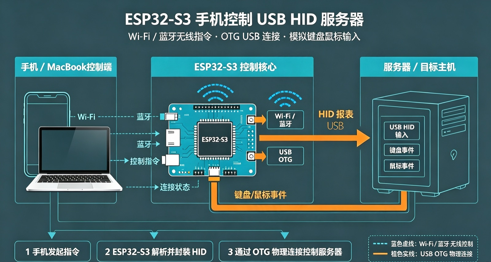
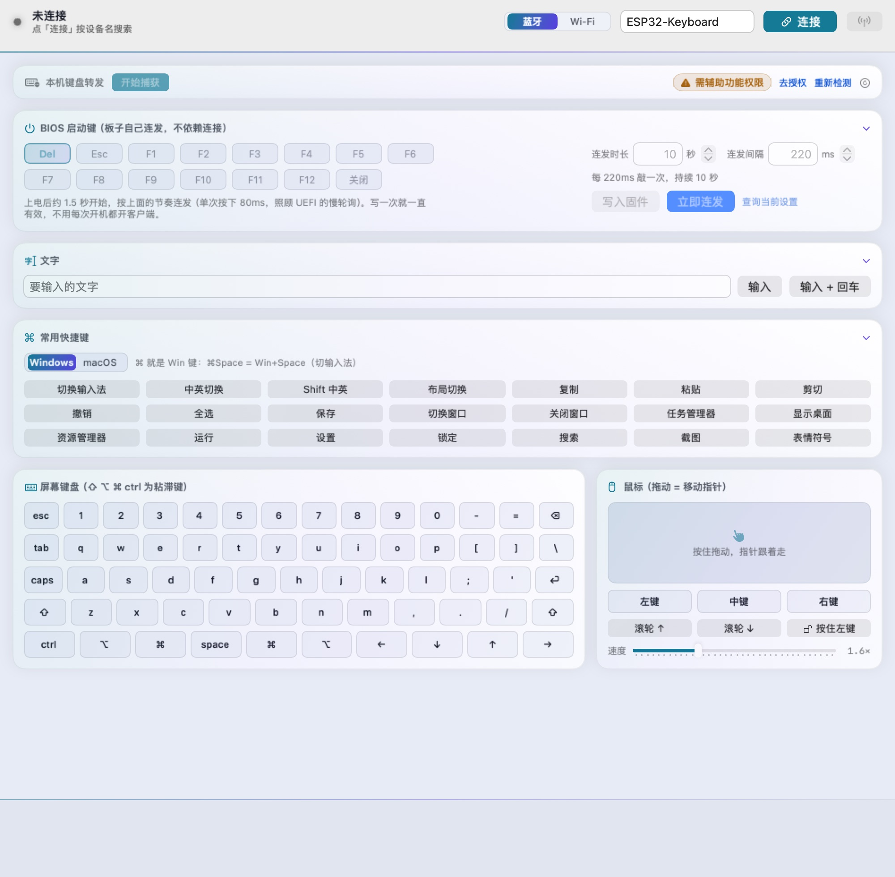
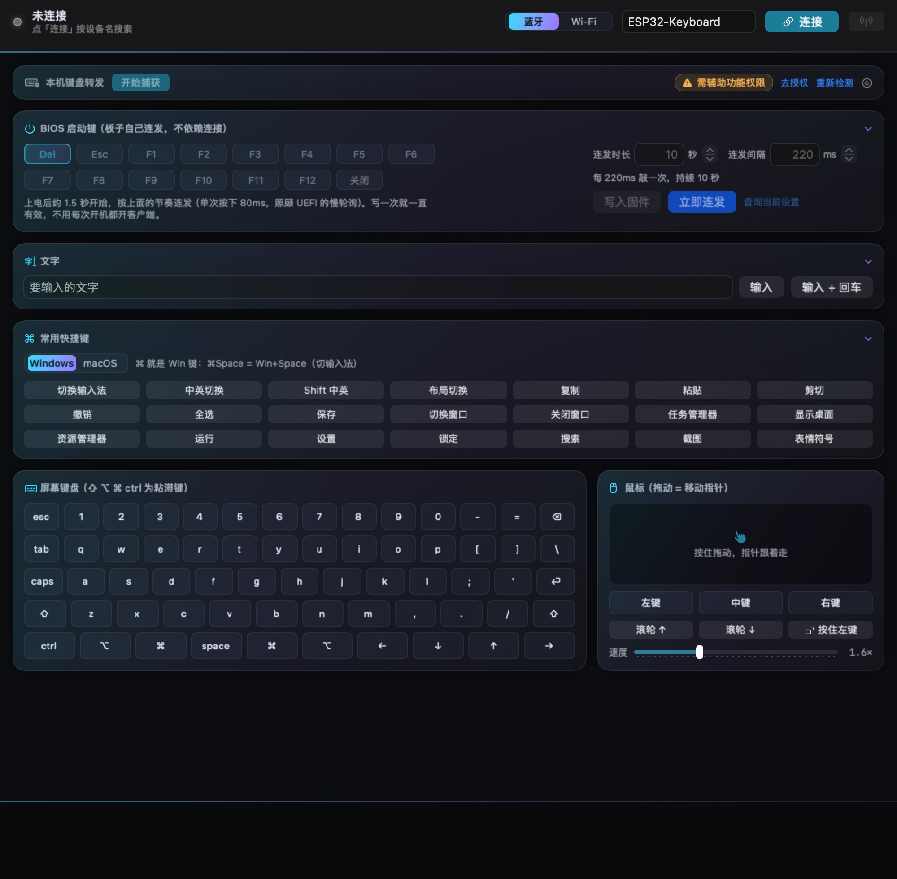
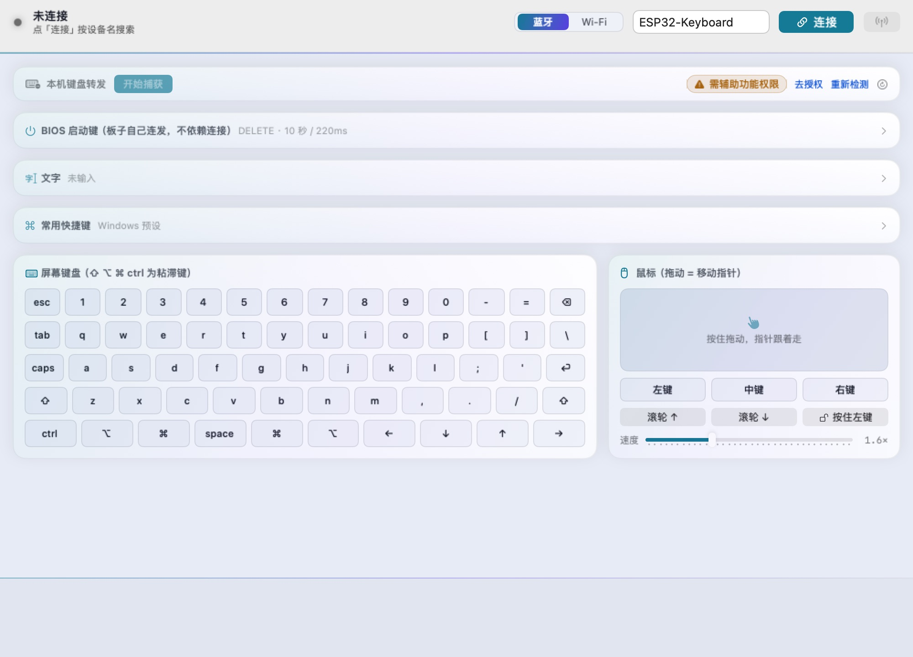
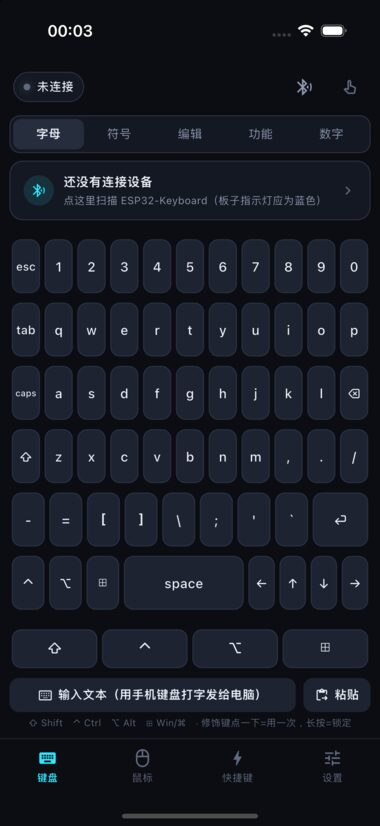
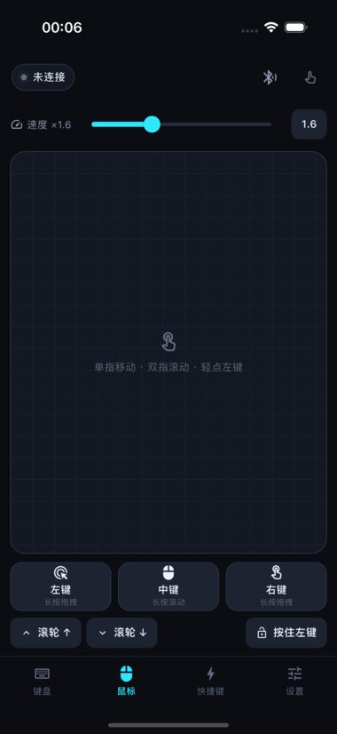
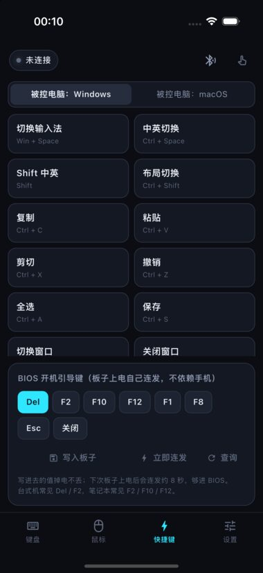
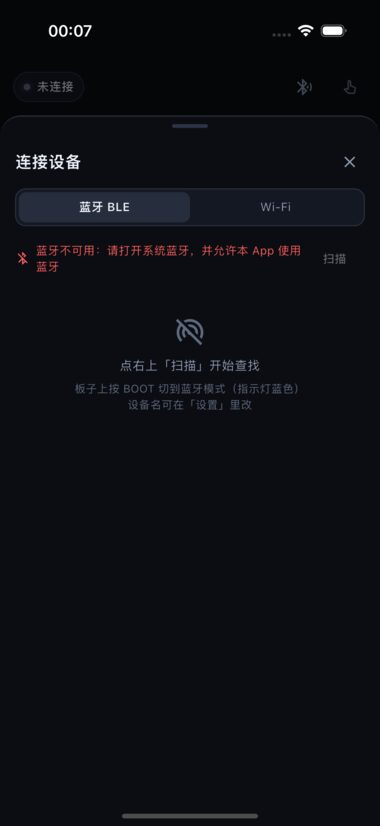

# ESP32-S3 无线键盘桥（USB HID over BLE / Wi-Fi）

一块 ESP32-S3 插在被控主机的 USB 口上，充当**标准 USB 键盘 + 鼠标**；你的 Mac / Windows / **手机**
通过 **蓝牙** 或 **Wi-Fi** 把按键发过去。被控主机免驱、不改设置，插上就认，Mac / Windows / Linux / BIOS 通吃。



关键点：**BLE / Wi-Fi 只是控制链路，不是把 ESP32 配成电脑的蓝牙键盘**。所以本机键盘触控板完全不受影响，
被控主机那边看到的是一个彻底的普通 USB 键盘。

| 层 | 角色 | 做什么 |
| --- | --- | --- |
| 控制端 | Swift / Python / Flutter 客户端 | 产生按键、鼠标事件，编码成一行行 ASCII 命令 |
| 传输层 | BLE 自定义 GATT 或 Wi-Fi AP + TCP | 只搬文本，20 字节一片，`\n` 分帧 |
| 执行端 | ESP32-S3 固件 | 解析命令 → USB HID 报告 → OTG 口发给主机 |

## 主要功能

- **双链路**：蓝牙 BLE 或 Wi-Fi 热点直连，板载 BOOT 键切换，RGB 灯用颜色区分状态（蓝/紫、绿/黄）。
- **灯会说人话**：链路状态看底色（蓝/紫、绿/黄），每执行完一条命令再白闪一下，**闪几下 = 命令有多长**
  ——被控主机全屏或者手机盲打长文本时，灯是唯一还看得见的回执。
- **复合 HID**：键盘、鼠标、多媒体键共用一个 USB 设备（report ID 1 / 2 / 4），一根线全搞定。
- **本机键盘转发**：接管控制端键盘，按键原样转给主机；修饰键全量镜像，能敲 Win+Space / Ctrl+Space 切输入法。
  Swift 版还能从**菜单栏图标**直接开 / 停捕获（窗口关掉了也停得下来）。
- **屏幕键盘 + 鼠标触控板**：没带键盘或只想点两下时用，和本机转发走同一条发送路径。
- **进 BIOS / UEFI**：引导键写进固件 NVS（掉电保持），上电自己连发，不依赖链路是否已连上。
- **纯文本协议**：`TAP:enter`、`COMBO:ctrl+alt+del`、`MOUSE:move 12 -7`，任何语言都能写客户端。
- **三个客户端**：Swift 版（macOS 原生）、Python 版（macOS / Windows，含命令行模式）、
  Flutter 版（Android / iOS，手机当遥控器）。
- **手机随便用**：躺床上、开会上、接线时，手机直接当键盘鼠标使——不用把电脑搬到身边。

## 硬件

- ESP32-S3 开发板，必须有**原生 USB**（GPIO19 = D-、GPIO20 = D+）。
- 用板上的 **USB / OTG 口**接被控主机（不是 UART 调试口），供电也走这个口。

## 一、烧固件

Arduino IDE 2.x + esp32 核心 3.x（实测 3.3.1）。板卡选 **ESP32S3 Dev Module**，然后：

| 选项 | 值 |
| --- | --- |
| USB Mode | **USB-OTG (TinyUSB)** ← 默认不是它，必须手动改，否则 `USBHIDKeyboard` 链接不出来 |
| USB CDC On Boot | Enabled（USB 口上多个串口看日志，不影响 HID） |
| Flash Size / PSRAM | 按模组选 |
| Partition Scheme | 默认 |

命令行编译（`arduino-cli`）：

```bash
arduino-cli compile --fqbn "esp32:esp32:esp32s3:USBMode=default,CDCOnBoot=cdc" esp32s3_ble_keyboard
```

烧录时 IDE 找不到端口：按住 **BOOT**，点一下 **RST**，松开 BOOT 再上传（程序跑起来后 USB 是 HID，重烧都要这样进下载模式）。

烧完串口会打印 `[BLE] 广播中，设备名: ESP32-Keyboard`；把 USB 口插到被控主机上，主机就把它识别成键盘。
想改设备名 / UUID 改文件顶部常量。

动过固件参数（闪灯 `LED_CMD_*`、引导键 `BOOTKEY_*`）的话，这两个离线测试不用板子也能跑——
它们直接把 `.ino` 里对应的代码段抠出来编译执行，测的就是固件里那份代码：

```bash
./tools/test_led_flash.sh      # 指令闪灯：命令长度 → 闪几下、节奏、排队上限
./tools/test_bootkey_cmd.sh    # 引导键命令：参数解析、越界夹取、回执格式
```

## 二、用客户端

发布包在 [Releases](https://github.com/chenjijun/esp32s3-usb-hid-keyboard/releases)：

| 包 | 平台 | 说明 |
| --- | --- | --- |
| `ESP32-RemoteKeyboard-*.dmg` | macOS | Swift 版，原生界面，拖进应用程序即可 |
| `ESP32KeyboardSwift-*.zip` | macOS | Swift 版源码 + 编译脚本 |
| `ESP32Keyboard-Python-*.zip` | macOS | Python 版（启动壳 + 源码） |
| `ESP32Keyboard-Python-*-windows.zip` | Windows | Python 版源码 + 一键打包脚本（`build_win.bat`） |
| `ESP32Keyboard-Mobile-*.apk` | Android | 手机端，直接安装（需要 Android 8.0+） |
| `ESP32KeyboardMobile-*.zip` | iOS / Android | 手机端源码（Flutter），可用 Xcode / Android Studio 自己打包 |

板子上按 **BOOT** 键选链路：BLE 灯蓝色（未连）→ 紫色（已连）；Wi-Fi 灯绿色（未连）→ 黄色（已连）。
客户端里选同一种链路，点「连接」。

灯还会报指令：**每执行完一条命令白闪一下，闪 1~6 下由命令长度决定**（`TAP:q` 闪 1 下，
`TYPE:` 一整段话闪 6 下）。闪的时候白，两下之间露出底色，所以链路状态和「命令有没有进去」
能同时看出来。`MOUSE:move` / `MOUSE:wheel` 这种 30Hz 的高频流不闪，鼠标按键（按下/松开/单击）照闪。

- **蓝牙**：直接扫设备名 `ESP32-Keyboard`。
- **Wi-Fi**：电脑先连热点 `ESP32-Keyboard` / 密码 `esp32keyboard`，主机填 `192.168.4.1`、端口 `8266`。

### Swift 版（macOS）

```bash
./mac_swift/make_cert.sh      # 只需一次：造一张本机自签证书，把签名身份固定下来
./mac_swift/build.sh          # 编译出 ESP32KeyboardSwift.app（之后每次都会自动用它签名）
open ESP32KeyboardSwift.app
```

首次运行要授权两次：**蓝牙**（系统弹窗点允许）和 **辅助功能**（系统设置 → 隐私与安全性 → 辅助功能，
勾选本 App）。从别的签名方式换过来的**那一次**要重新授权，之后重编不会再问。

那张证书是干什么的：macOS 的隐私授权按「代码签名身份」记账，而 ad-hoc 签名的唯一标识是每次编译都会变的
cdhash，于是重编一次就等于换了个 App，授权白给。换成固定证书后，签名指定要求里是
`certificate leaf = H"…"`（不含 cdhash），重编一百次系统都认同一个 App。
想确认随时可以跑 `codesign -d -r- ESP32KeyboardSwift.app` 看这一行。
注意 App 的**路径**也别换来换去：仓库根目录和 `/Applications` 在授权里是两条记录，
固定用其中一个（`./mac_swift/build.sh --install` 可以装到 /Applications 并启动）。

证书装在专用钥匙串 `~/Library/Keychains/esp32-signing.keychain-db` 里（不是登录钥匙串），
密码固定、只保护这一张自签证书。这么做是为了让 `codesign` 读私钥时不弹授权框——
那个框在没有图形界面的环境里根本不会出现，签名会一直卡住不动。

配色跟随系统明暗，强调色是一条青 → 紫的渐变（浅色 / 深色两套都是同一份 `Theme.swift` 里的动态色）：

| 浅色 | 深色 |
|---|---|
|  |  |

BIOS 启动键、文字、常用快捷键三块可以点标题栏折叠，收起后留一句概要（截图里是折叠状态）：



**菜单栏常驻一个捕获开关**：菜单栏图标平时是键盘，开始捕获后变成录制圆点，点开就能
「开始捕获 / 停止捕获」「释放全部按键」，没授权时还有「去授权」「重新检测」。
它不是个装饰——捕获期间本机键盘被整体吞掉，主窗口那个按钮只能用鼠标点，
窗口一旦被盖住或关掉（关窗口不退进程）就没别的出口了，菜单栏这一项是那时唯一还点得到的地方。
代价是捕获期间菜单里的键盘导航（方向键 / Esc）也会被一起吞掉，用鼠标点即可。

### Python 版

```bash
python3 -m pip install -r mac_client/requirements.txt
./mac_swift/make_cert.sh      # 只需一次：和 Swift 版共用同一张自签证书
./mac_client/build_app.sh     # 生成 ESP32Keyboard.app（带蓝牙用途声明，固定证书签名）
open ESP32Keyboard.app
```

macOS 上**别**用 `python3 ble_keyboard_client.py` 直接开：TCC 只认带蓝牙声明的 App，裸进程会被系统直接杀掉。
命令行模式可以用：

```bash
python3 mac_client/ble_keyboard_client.py --cli                # 蓝牙
python3 mac_client/ble_keyboard_client.py --cli --mode wifi    # Wi-Fi
```

`build_app.sh` 和 Swift 版共用 `make_cert.sh` 造的那张证书，所以**重新打包也不会掉授权**（要跑过一次
`make_cert.sh`，没跑就会退回 ad-hoc 并在结尾警告）。两个 App 的 bundle id 不同，系统里是两条独立的授权记录，
各点一次即可。和 Swift 版一样，别把仓库根目录和 `/Applications` 里的两份 App 混着用。

Windows 没有现成的 exe（PyInstaller 不能跨平台编译），下载 `*-windows.zip` 后：

1. 装 Python 3.9+（python.org 安装包，勾选 *Add python.exe to PATH*）；
2. 双击 `mac_client\build_win.bat`，脚本会建虚拟环境、装 bleak 和 PyInstaller、打包并压成 zip；
3. 用 `dist_win\ESP32Keyboard\ESP32Keyboard.exe` 启动。也可以不打包，直接
   `python ble_keyboard_client.py` 跑。

Windows 上键盘转发不需要授权，但系统不允许拦截 `Ctrl+Alt+Delete`，也收不到「以管理员运行的窗口」的按键
（想让它们也生效，就右键 exe → 以管理员身份运行）。窗口宽度按内容自动撑开（约 1290），建议 1440×900 以上分辨率。

电脑端两个客户端都支持：屏幕键盘（粘滞修饰键）、鼠标拖拽区 + 三键 + 滚轮 + 按住左键、常用快捷键预设、
**BIOS 引导键 F1~F12 全键位 + 连发时长/间隔 + 写入固件**、日志面板。停下本机键盘转发：点「停止」，或按
`Ctrl+Shift+E`（备用 `Ctrl+Alt+Esc`）。

BIOS 引导键这块，**以固件为准**：每次连上客户端都会自动问一次 `BOOTKEY:?`，卡片显示的是板子里真正
存着的值（不是你上次点过的值），「关闭」写进去之后断电、重刷都不会再敲键。

两边也都支持**折叠**和**换肤**：

- **BIOS 启动键 / 文字 / 常用快捷键**三张卡点标题栏收起，收起后标题右边留一句概要
  （`DELETE · 10 秒 / 220ms`、输入的文本、`macOS 预设`）。折叠状态记在本地，下次打开还是收着的样子。
- 配色跟随系统明暗，强调色是青 → 紫；Python 版右上角有个「外观」按钮，可以在
  **跟随系统 / 浅色 / 深色** 之间当场切换（Tkinter 画不了渐变，用的是同一组色值的纯色版本）。

改完 Python 版界面可以用 `python3 tools/test_python_ui.py` 自测（不用板子、不用连蓝牙）：
它会把窗口建起来量控件——折叠到底省了多少高度、每处文字的对比度、点一下发的是哪条协议命令。

### 手机端（Android / iOS）

<p>




</p>

**先说清楚一件事**：iOS / 安卓都不允许普通 App 抓本机键盘（没有 macOS 那种辅助功能授权的口子），
所以手机端不转发手机键盘，而是「遥控器」形态——屏幕键盘 + 鼠标触控板 + 文本框打字 + 快捷键。想要
「按手机键盘、电脑出字」的效果，用文本框那条路（见下）。

功能：

- **蓝牙 / Wi-Fi 双链路**：扫描列表里挑 `ESP32-Keyboard` 直接连；Wi-Fi 填板子热点地址即可。
- **屏幕键盘**：字母 / 符号 / 编辑 / 功能 / 数字 五页，粘滞修饰键（点一下=用一次，长按=锁定），
  横屏自动换成宽排布。
- **文本框打字**：用手机输入法把整段文字发过去（逐字符 `TYPE:`），支持「发送后按回车」。
- **鼠标**：单指移动、双指滚动、轻点左键；左/中/右三键（长按=按住）、按住左键拖拽、速度倍率。
- **快捷键**：Windows / macOS 两套预设（切换输入法、任务管理器、截图…），BIOS 引导键写入 / 连发 / 查询。
- **状态可视化**：延迟、CapsLock/NumLock、固件当前引导键、运行日志。

安装：

- **Android**：下载 `ESP32Keyboard-Mobile-*.apk` 安装（首次会请求「附近的设备」权限，必须允许）。
- **iOS**：App Store 之外没有现成包（需要开发者证书签名），用源码自己打包，见下。

自己打包（需要 Flutter 3.35+）：

```bash
cd mobile_client
flutter pub get
flutter build apk --release                       # → build/app/outputs/flutter-apk/app-release.apk
flutter build ios --release --no-codesign         # Xcode 里再签名，或用 Xcode 直接 Run
```

Android 真机调试直接 `flutter run -d <设备>`；iOS 用 Xcode 打开 `mobile_client/ios/Runner.xcworkspace`
选自己的开发者账号即可。

> 手机端为什么不能像电脑端那样接管键盘：系统层面就不给这个权限。所以这里刻意做成了「遥控器」，
> 而不是假装能替代电脑端。

## 三、通信协议

BLE 特征 `...def1` 上按行写 ASCII，`\n` 结尾；Wi-Fi 是 TCP 直连，同样的行。

| 命令 | 说明 | 示例 |
| --- | --- | --- |
| `TAP:<键>` | 按一下 | `TAP:enter` |
| `DOWN:<键>` / `UP:<键>` | 按下 / 松开（修饰键走这条） | `DOWN:lshift` |
| `TYPE:<文本>` | 逐字符输入 | `TYPE:hello` |
| `COMBO:<键>+<键>…` | 组合键，依次按下再逆序松开 | `COMBO:cmd+shift+4` |
| `MEDIA:<名称>` | 多媒体键 | `MEDIA:volup` |
| `RELEASEALL` | 松开所有键 | `RELEASEALL` |
| `PING` | 心跳，回 `PONG:<millis>,leds=<位图>` | `PING` |
| `BOOTKEY:<键>` / `off` / `now` / `?` | 设 / 关 / 立即连发 / 查询引导键 | `BOOTKEY:f2` |
| `BOOTKEY:window <ms>` / `BOOTKEY:gap <ms>` | 连发时长（1000~60000）/ 间隔（60~5000），写 NVS | `BOOTKEY:window 8000` |
| `MOUSE:move <dx> <dy>` | 相对位移，单条 ±127（client 会自动拆条） | `MOUSE:move 12 -7` |
| `MOUSE:wheel <n>` | 滚轮，正数向上 | `MOUSE:wheel 3` |
| `MOUSE:down/up/click left\|middle\|right` | 鼠标键 | `MOUSE:click right` |
| `MOUSE:release` | 松开所有鼠标键 | `MOUSE:release` |

键名：单字符直接写（`a`、`1`、`/`，需要 Shift 的由库自动补）；命名键有
`enter` `esc` `tab` `space` `backspace` `delete` `insert` `home` `end` `pageup` `pagedown` `up` `down` `left` `right`
`capslock` `printscreen` `menu` `f1`~`f24` `kp0`~`kp9` 等；修饰键 `ctrl` `shift` `alt` `cmd`（= Win/GUI），
每个都带 `l`/`r` 侧别（`lshift`、`rctrl`…）。

固件回执（客户端不用全认，认不认识都不影响发命令）：

| 回执 | 含义 |
| --- | --- |
| `PONG:<millis>,leds=<位图>` | 心跳回应，`leds` 是主机灯态（1=NumLock 2=CapsLock 4=ScrollLock） |
| `BOOTKEY:<键>` | 引导键变更后的确认（`off` = 已关闭） |
| `BOOTCFG:key=delete,win=10000,gap=220,hold=80` | 引导键的完整参数：键名 / 连发时长 / 间隔 / 单次按下 |
| `BOOTKEY-ERR:<键>` | 固件不认这个键名 |

## 四、常见问题

**插上没反应 / 主机不认识？** 看 USB Mode 是否选了 `USB-OTG (TinyUSB)`；换线；确认用的是板上的 USB 口而不是 UART 口。

**蓝牙连不上？** 确认板子灯是蓝色（BLE 模式）且没被别的设备占着；Windows 上要确认本机有蓝牙适配器。

**灯一直白闪 / 我不想看它闪？** 白闪是「命令已经出去」的回执，闪着说明客户端在发东西
（一次最多连闪 6 下，约 0.6 秒，然后自动停）。嫌烦把固件顶部 `LED_CMD_FLASH` 改 0，灯就只表示链路状态；
觉得太快/太亮，调 `LED_CMD_ON_MS`、`LED_CMD_GAP_MS`、`LED_CMD_MAX_BLINKS` 和 `LED_BRIGHTNESS`。

**Wi-Fi 连不上？** 电脑要连的是板子开的热点 `ESP32-Keyboard`，主机地址是 `192.168.4.1`，端口 `8266`。

**按键卡住 / 主机一直按着某个键？** 点「释放全部按键」（发 `RELEASEALL`），断开连接和关窗口也会自动松键。

**本机键盘转发没反应？** macOS 看「辅助功能」授权。重编后又被要求授权，说明还在用 ad-hoc 签名：
跑一次 `./mac_swift/make_cert.sh` 再编译，之后就不用反复勾了（详见上面 Swift 版那节）。
Python 版同理——`build_app.sh` 会找同一张证书，没找到就退回 ad-hoc 并提示。
Windows 看是否被安全软件拦了键盘钩子。

**手机扫不到设备？** Android 12+ 要允许「附近的设备」权限；iOS 要允许蓝牙。手机上如果同一个键盘桥已经被电脑连着，
先让电脑断开——ESP32 同一时间只接一个客户端。

**手机 Wi-Fi 连不上？** 先在系统设置里连板子热点 `ESP32-Keyboard`；iOS 会弹「是否允许访问本地网络」，
必须允许；安卓可能提示「此 WLAN 无法访问互联网」，选择保持连接即可。

**手机上打不出中文？** 固件是逐个 HID 键码敲字符的，只能出 ASCII。要打中文，在被控电脑上切好输入法再敲。

**能进 BIOS 吗？** 能，引导键写在固件里，上电自己连发，跟链路连没连无关。注意部分主板要关掉「快速启动」。

**安全吗？** 这是个遥控键盘，能操作被控主机的一切。别在不受控的环境里开着本机键盘转发，用完点「停止」。

## 五、目录结构

```
├── esp32s3_ble_keyboard/esp32s3_ble_keyboard.ino  # 固件（单文件自包含）
├── mac_swift/                                     # Swift 版客户端 + build.sh / package.sh
│   ├── Sources/Theme.swift                        # 品牌配色（跟随系统明暗）、卡片与分段控件
│   ├── Sources/MenuBar.swift                      # 菜单栏图标与下拉菜单（开 / 停捕获）
│   ├── make_cert.sh                               # 造本机自签证书，固定签名身份（只需一次）
│   └── .sign-identity                             # 上次用的签名身份（build.sh 自动写，不进库）
├── mac_client/                                    # Python 版客户端（macOS / Windows）
│   ├── ble_keyboard_client.py                     # 协议 / 链路 / 键盘钩子 / 配色 / 界面 / CLI
│   ├── build_app.sh  package_app.sh               # macOS 打包（用 make_cert.sh 那张证书签名）
│   └── build_win.bat  windows/README.txt          # Windows 打包
├── mobile_client/                                 # Flutter 手机端（Android / iOS）
│   ├── lib/core/                                  # 协议 / 链路 / 状态（不依赖界面，可单测）
│   ├── lib/ui/                                    # 键盘、鼠标、快捷键、设置、连接面板
│   ├── test/protocol_test.dart                    # 含「与固件键表逐项比对」
│   └── integration_test/                          # 手机端端到端测试（假 TCP 服务端）
├── tools/make_ico.sh                              # app_icon.png → .ico / 256px png
├── tools/make_mobile_icons.sh                     # app_icon.png → Flutter 图标资源
├── tools/test_led_flash.sh                        # 指令闪灯的离线测试（不用板子）
├── tools/test_bootkey_cmd.sh                      # 引导键命令解析的离线测试（不用板子）
├── tools/test_python_ui.py                        # Python 版界面自测（折叠 / 对比度 / 命令）
├── app.png  app_icon.png                          # 架构图原图 / 图标源图
├── docs/architecture.jpg                          # README 用的架构图
├── docs/swift/                                    # Swift 端浅色 / 深色 / 折叠态截图
└── docs/ARCHITECTURE.md                           # 详细实现说明（代码地图、设计取舍）
```

## 六、许可

[MIT](LICENSE) © 2026 chenjijun

更细的实现说明（一次按键走过的完整路径、固件代码分段地图、几个设计取舍）见 [docs/ARCHITECTURE.md](docs/ARCHITECTURE.md)。
